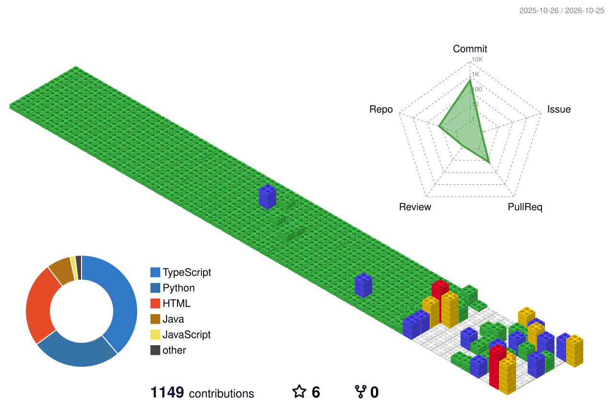

<div align="center">


<a href="https://readme-typing-svg.demolab.com">

</a>

<br/>

<a href="https://github.com/GouravSharma26">

</a>


<br/><br/>

`DESIGNING SYSTEMS` &nbsp;·&nbsp; `WRITING CODE` &nbsp;·&nbsp; `SOLVING PROBLEMS`

</div>

---

## `01` &nbsp; 👨‍💻 About Me

```python
class GouravSharma:
    name = "Gourav Sharma"
    education = "B.Tech Computer Science and Engineering"

    languages = ["Python", "C++", "SQL"]

    interests = [
        "Software Engineering",
        "Artificial Intelligence",
        "Data Engineering",
        "Application Security",
    ]

    philosophy = "Build. Test. Learn. Improve."
```

I'm a Computer Science and Engineering student who enjoys turning ideas into practical software. My interests span full-stack development, AI-powered applications, data engineering, and software security.

I focus on building complete systems—from application interfaces and backend APIs to data pipelines, database models, and developer tools.

- 🔭 **Building:** Full-stack applications, AI agents, and developer tools.
- 🤖 **Exploring:** AI/ML, intelligent automation, and applied machine learning.
- 📊 **Working with:** Data pipelines, SQL analytics, and relational databases.
- 🔐 **Interested in:** Secure coding, static analysis, and software reliability.
- 🎯 **Goal:** Build useful, maintainable software and grow as an engineer.

---

## `02` &nbsp; ⚡ Tech Stack

<div align="center">

**LANGUAGES**


<br/><br/>

**FRONTEND & BACKEND**


<br/><br/>

**DATABASES, TOOLS & INFRASTRUCTURE**


<br/><br/>


</div>

---

## `03` &nbsp; 🚀 Featured Projects

<div align="center">

<table>
<tr>
<td width="50%" valign="top">

<h3>🏠 RoomGenie AI</h3>

**AI-Assisted Interior Design**

An AI-powered interior design application that combines an interactive 3D room editor with intelligent design proposals and furniture-placement workflows.

**Core features**

- Interactive 3D room editing.
- AI-generated interior design proposals.
- Design proposal validation and application.
- Session ownership and controlled state updates.

**Stack**

`React` `Django` `PostgreSQL` `Three.js`

<a href="https://github.com/GouravSharma26/RoomGenie-ai">

</a>

</td>
<td width="50%" valign="top">

<h3>🛡️ SymGuard</h3>

**Python Static Analysis & Security**

A static analysis tool that detects potentially dangerous coding patterns and reports findings through a structured, source-aware analysis workflow.

**Core features**

- Security rules for risky Python operations.
- Stable rule identifiers and source locations.
- Structured findings for automated workflows.
- Regression checks and CI integration.

**Stack**

`Python` `Static Analysis` `Security` `GitHub Actions`

<a href="https://github.com/GouravSharma26/SymGuard">

</a>

</td>
</tr>
<tr>
<td width="50%" valign="top">

<h3>🏦 BankFlow</h3>

**Banking Transaction ETL & Analytics Warehouse**

A data engineering system that transforms synthetic banking transactions into validated datasets and analytical warehouse models.

**Core features**

- Synthetic transaction generation.
- Data validation and quarantine workflows.
- Idempotent warehouse loading.
- SQL analytics and transaction reconciliation.

**Stack**

`Python` `PostgreSQL` `SQL` `Docker`

<a href="https://github.com/GouravSharma26/BankFlow">

</a>

</td>
<td width="50%" valign="top">

<h3>📚 E-Book Management System</h3>

**Full-Stack Book Shopping Application**

A web application for an online book-shopping experience, integrating a React frontend with a Django backend and PostgreSQL database.

**Core features**

- Full-stack application architecture.
- Frontend and backend integration.
- Relational database-backed functionality.
- Book-shopping workflows.

**Stack**

`React` `Django` `PostgreSQL`

<a href="https://github.com/GouravSharma26/E-Book-System">

</a>

</td>
</tr>
</table>

</div>

---

## `04` &nbsp; 🌆 Contribution City

<div align="center">

### My GitHub activity, visualized in 3D

<!-- Generated by yoshi389111/github-profile-3d-contrib -->


<br/>

*Every contribution builds something bigger.*

</div>

---

## `05` &nbsp; 📊 GitHub Dashboard

<div align="center">


<br/><br/>


</div>

---

## `06` &nbsp; 🧩 What I'm Interested In

<div align="center">

<table>
<tr>
<td align="center" width="25%">

### 🤖

**AI Engineering**

Intelligent applications and AI-assisted workflows.

</td>
<td align="center" width="25%">

### 🔐

**Software Security**

Static analysis and secure development tools.

</td>
<td align="center" width="25%">

### 📊

**Data Engineering**

ETL pipelines, warehouse models, and analytics.

</td>
<td align="center" width="25%">

### 🌐

**Full-Stack Development**

Interactive interfaces and backend systems.

</td>
</tr>
</table>

</div>

---

## `07` &nbsp; 🤝 Connect With Me

<div align="center">

**Always open to learning, collaborating, and building useful things.**

<br/>

<a href="https://github.com/GouravSharma26">

</a>

<!-- Replace the URL below with your actual LinkedIn profile. -->
<a href="https://www.linkedin.com/">

</a>

<br/><br/>


`BUILD WITH PURPOSE. SHIP WITH CONFIDENCE.`

</div>
